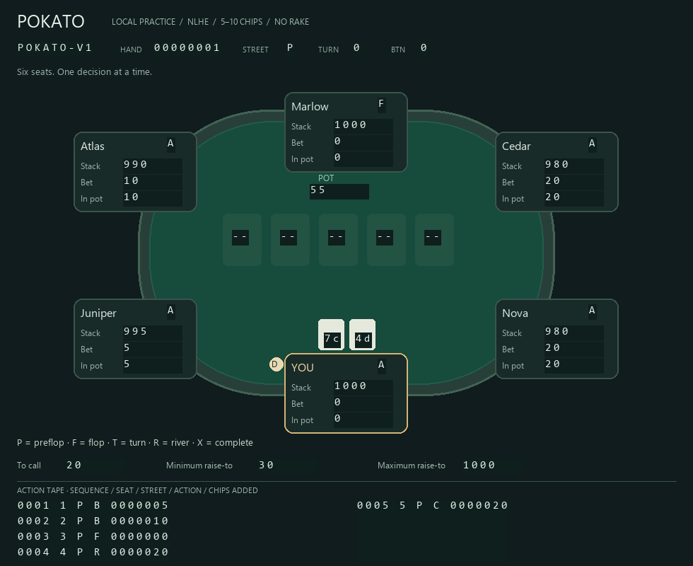

# Pokato

A Windows desktop Texas Hold'em practice table with a screen-reading coach.
Play one six-seat table against five simulated opponents. A floating HUD reads
the table's **actual rendered pixels**, reconstructs actions, tracks observed
opponent behavior, and displays range equity, pot odds and estimated action EV.

This milestone runs entirely locally. ClubWPT Gold and HD Poker adapters are
not included.



[Preview the floating coach](docs/hud-preview.png).

## Run on Windows

For the standalone build, double-click **`dist\Pokato.exe`**. It includes Python,
Tk, Pillow, and the application; no installation or console window is required.
You can move that single file to another folder. Statistics still live under
your user profile, so the executable's folder does not need to be writable.
This is the one app for all features, including Bayesian turn/river analysis and hand
review. Future builds update this same file; close Pokato before rebuilding.

To run from source:

Requires Python **3.10+** with Tk. On this workstation, plain `python` selects
3.8, so select 3.12 explicitly:

```powershell
py -3.12 -m venv .venv
.\.venv\Scripts\python.exe -m pip install -e .
.\.venv\Scripts\python.exe -m pokato
```

No API key, server, account, or GPU is required. Pillow is the only third-party
runtime dependency. The standard Windows Python installer includes Tk.

```powershell
.\.venv\Scripts\python.exe -m pokato --seed 42 --samples 800 --database .pokato\practice.sqlite3
```

- **Fold / Check / Call / Raise:** act when the gold outline reaches YOU.
- **Raise to:** total contribution on this street, not additional chips.
- **Deal next hand:** available after the hand completes.
- **Pause bots:** pauses opponents while observation continues.
- **Review hands:** browse saved snapshots, edit ranges and compare per-pot EVs.
- **H:** reopen the HUD after closing it.
- Close the practice-table window to exit both windows.

Both windows use a custom borderless frame. Drag the header to move; drag any
edge or the bottom-right grip to resize. Click the square button or double-click
the header to maximize/restore. The minus minimizes; the cross closes the coach
or exits the table. **Show coach** reopens a hidden or minimized HUD.

The coach starts at 94% opacity. Click **94%** in its footer to cycle between
88%, 100%, and 94%.

The default HUD targets **7% of the monitor's usable area**: roughly **960 × 640**
on a 3840 × 2400 laptop after allowing for the taskbar. Cards and board, position,
pot, call cost, equity, break-even pot odds, recommendation, and action EVs are
visible together without scrolling. Smaller screens use a readable minimum.
Click **Details** for opponent history, numerical uncertainty, and calculation
assumptions; only this optional region scrolls. **Less** returns to the compact
overlay. Widening the details view gives its supporting panels two columns.

### Readable text on laptops and high-DPI monitors

HUD typography balances display DPI with the compact screen-area budget. The
4K default uses approximately 30-pixel body text, larger cards and recommendation
text, and compact spacing. Ordinary 100% displays start with 16-pixel body text.
Window defaults fit the monitor's usable area. Real font measurements keep the
crucial widgets visible; larger manual zoom can expand the window when necessary.

Use **A− / A+** in the coach's footer to adjust text from 80% to 200% of the
automatic size. **Reset** restores the display-aware default. Keyboard shortcuts
are **Ctrl + / Ctrl − / Ctrl 0**, and **Ctrl + mouse wheel** also adjusts text.
The setting is saved in `%USERPROFILE%\.pokato\settings.json` and remains relative
to display DPI, so moving the HUD to another monitor updates its physical size.

Blinds are 5/10 chips, stacks start at 1,000, and rake is zero. The button rotates
and busted players automatically rebuy. Betting rules include short all-ins,
reopening, uncalled refunds, split pots, and side pots.

The optical reference is **980 × 800 physical pixels**. The table scales to its
viewport while preserving its aspect ratio; the reader calibrates compact
glyphs at scales down to 50% and normalizes enlargement to the reference.
Controls wrap on smaller screens. Screen text scaling is independent of optical
recognition, and window defaults stay within the monitor's work area.
Windows capture targets only the practice widget's HWND;
covering it with another app does not turn that app into input. Minimizing the
practice window withholds advice.

## Understanding the coach

| Display | Meaning |
| --- | --- |
| Range equity | Expected showdown share against heuristic weighted ranges, including ties and sampled future cards |
| Exact river | Enumerates compatible opponent assignments up to 20,000 candidate deals; range assumptions remain uncertain |
| Break-even equity | Call cost / eligible pot after calling; shown when there is one contestable pot |
| Heads-up river EV | Bounded tree with checks, calls, folds, multiple bet sizes and reraises; later decisions use updated ranges |
| Other check/call EV | Contribution-specific payouts minus call cost; freezes contributions after your action, omitting remaining decisions and future betting |
| Other raise EV | One sizing with strength-conditioned folds/calls, then showdown; no reraises or future bets |
| ± intervals | Approximate 95% Monte Carlo sampling intervals, excluding model uncertainty |
| Sampling tie | The estimated ranking is unclear at the current sample count |
| All-in / side pot | Call/check EV includes eligibility, integer splits and refunds; heads-up rivers use the legal tree, other all-in states omit raises |

Recommendations rank supported modeled scenarios. They are not GTO solutions or
evidence of a winning strategy. The coach conditions weighted opponent ranges on
joint card compatibility; folded players' hidden-card distributions are omitted.
HUD equity is payout share weighted over contestable pots you can win.
See [architecture and limitations](docs/ARCHITECTURE.md).

Opponent statistics persist in `%USERPROFILE%\.pokato\practice.sqlite3`, unless
`--database` is supplied. Live adaptation uses **only the current app session**;
older sessions remain available for replay. Identities refer to fixed practice characters. VPIP/PFR
denominators count hands with an observed preflop decision; fold-versus-bet
counts actual facing-bet decisions. Raw counts are shown, with smoothed rates
used internally. The normal app retains no screenshots or video. Delete the
database while the app is closed to reset statistics and saved hands.

## Saved-hand review (milestone 2)

Play to your turn, then click **Review hands**. Observed snapshots are saved
automatically, including completed and partial hands. Practice bots pause while
the review window is open. Closing it restores their previous pause state.

Select a hand and use **First / Previous / Next / Next decision / Last** to step
through the recorded timeline. Only public information and your visible cards
are archived; opponents' hidden cards never enter replay or analysis. The
profile evidence for each snapshot is frozen at capture time, so later hands
cannot change an old analysis's automatic prior.

At your turn, enter a range for each opponent and click **Calculate & save**.
The results compare original and scenario action EVs, including deltas, sampling
uncertainty and each pot's eligibility/payout. These are sensitivity comparisons;
they do not establish that the edited range is correct.

| Range syntax | Meaning |
| --- | --- |
| `Auto` or blank | Use the saved evidence and heuristic range model |
| `QQ+` | QQ, KK, AA |
| `ATs+` | ATs, AJs, AQs, AKs |
| `AKo` | All offsuit AK combinations |
| `A♠K♥:0.5` | One exact combination with relative weight 0.5 |
| `*:1, AA:0` | All combinations except AA; later tokens override earlier ones |

Separate tokens with commas or spaces. Known cards block impossible combinations;
fully blocked or mutually conflicting opponent ranges produce an error. Card suits
display as ♣ ♦ ♥ ♠ throughout the app. Range and correction inputs also accept
typed letter suits, converting them for display while retaining compatible saved data.
Explicit ranges replace the automatic final range, including its action-history weighting.
They apply only to live opponents at the selected snapshot.

**Correct state…** edits cards and seat amounts in a separate scenario. The board
length and acting player stay fixed to that snapshot. Corrected states compare
check/call and fold, with raises disabled because their original bounds may no
longer be valid. Click **Calculate & save** to persist the correction and ranges.
**Reset** deletes the scenario and restores the original observation.

The SQLite migration is additive and keeps existing statistics. Older event-only
history lacks cards and stacks and cannot be reconstructed retroactively. Only
newly observed hands appear in review. Structured snapshots and scenarios persist
in the same database; screenshots and video remain unsaved by normal operation.

## Bayesian session adaptation and river trees (milestone 3)

Unfamiliar players start with conservative response priors, updated only by
observed decisions in the current session. **Details** shows baseline/adapting
status, opportunity counts, prior weight and marginal posterior intervals.
Starting the app creates a fresh session. Historical data remains in replay;
it does not seed a new player's estimates.

On supported heads-up rivers, the coach compares checks/calls/folds, one-third-
pot, two-thirds-pot and all-in sizings, with legal reraises. It searches up to
three additional bets/raises, then permits fold/call only. Opponent responses
update their range before the hero chooses a continuation. The compact HUD shows
the top three actions; **Details** and saved replay show every action and the
response branches. New snapshots freeze the Bayesian model at capture time.

These are posterior-mean best responses within a restricted model, not GTO or
proof of a winning strategy. [River model, limits and benchmark results](docs/RIVER.md)
explains the priors, context borrowing, hand-strength heuristics, fallback rules
and posterior intervals. Milestone 4 extends this to heads-up turns below;
preflop/flop/multiway decisions retain labeled scenarios.

```powershell
.\.venv\Scripts\python.exe scripts/river_smoke.py
.\.venv\Scripts\python.exe scripts/benchmark_river.py --pairs 1200 --seed 31
```

The packaged `dist\Pokato.exe` also supports
`--self-test-river <absolute-report-path>` for the new capture/model/replay path.

## Turn analysis and policy sensitivity (milestone 4)

On supported heads-up turns, the coach enumerates every compatible river card,
updates the opponent range for card removal and modeled actions, and searches
future river play. The bounded tree permits one additional turn bet/raise and
one river bet/raise with the existing three sizing choices, then fold/call only.
This is a restricted continuation model, not a full poker solver.

The compact HUD shows the best full-range modeled action EV and **policy
agreement**. **Details** adds approximate central 80% policy sensitivity bands
for every action and a graphic of the three highest/lowest river-card showdown
equities, with each card's probability. Saved replay shows all cards and the same
sensitivity calculations using frozen session evidence and deterministic seeds.
Card equity freezes contributions after check/call; it is distinct from strategy EV.

Sensitivity uses 24 sampled Bayesian response policies and at most 32 prior hands
to bound repeated calculation cost. Reduced-range EV changes are anchored to the
full-range point estimates. The display reports that approximation's size and
mean-policy shift; the shift is not an error bound. Agreement is a fraction of
sampled policies, not confidence that a recommendation is correct. Bands exclude
range-prior and behavioral-model misspecification. Broad ranges can take several
seconds to calculate; the UI stays available and rejects results from stale turns.
[Turn model and validation](docs/TURN.md) explains the calculations and limits.

```powershell
.\.venv\Scripts\python.exe scripts/turn_smoke.py
.\.venv\Scripts\python.exe scripts/benchmark_turn.py --draws 24 --hands 32 --reference-hands 64 --seed 31
```

The same `dist\Pokato.exe` supports `--self-test-turn <absolute-report-path>`.
It also retains the earlier self-test modes and hand-review features.

## Verify

```powershell
.\.venv\Scripts\python.exe scripts/validate.py
.\.venv\Scripts\python.exe scripts/desktop_smoke.py
.\.venv\Scripts\python.exe scripts/window_smoke.py
.\.venv\Scripts\python.exe scripts/readability_smoke.py
.\.venv\Scripts\python.exe scripts/replay_smoke.py
.\.venv\Scripts\python.exe scripts/river_smoke.py
.\.venv\Scripts\python.exe scripts/turn_smoke.py
```

Unit tests need no display. The smoke check opens and closes the local UI,
captures its Windows pixels, verifies the hand and HUD, and checks immediate
advice invalidation after an action. It writes ignored QA images/JSON under
`artifacts/` and requires an interactive desktop. GitHub Actions is configured
for unit tests on Windows with Python 3.10, 3.12, and 3.14.
The window smoke check exercises custom drag/resize gestures, maximize/restore,
minimize, transparency controls, HUD reflow, and recognition after table resizing.
The readability check opens real widgets with simulated 768p/1080p work areas
at 100% and 150%, plus a 4K work area at 250%. It checks auto-fit, font sizes,
saved zoom controls, optional details and pixel recognition without changing OS
settings. A full-board fixture verifies that all essential widgets fit without
clipping or scrolling, and the 4K overlay stays close to the 7% area target.
The replay check verifies captured-hand browsing, saved range sensitivity,
invalid-correction rejection, original immutability, reset and bot pause/restore.
The turn check verifies actual-pixel capture, exact card probabilities, policy
sensitivity, deterministic frozen replay and immediate advice/chart invalidation.
Numerical tests independently enumerate five-card hands and distribute chips
one at a time; random fixtures compare these references with production hand
ranks and payouts. A turn-runout fixture checks sampled payouts against exact
reference enumeration. These checks establish arithmetic, not strategic strength.

## Build the executable

On Windows, from the repository root:

```powershell
.\.venv\Scripts\python.exe -m pip install -e ".[build]"
powershell -ExecutionPolicy Bypass -File scripts\build_windows.ps1
```

Close Pokato before building. Each build updates the single-file GUI app at
`dist\Pokato.exe`; generated build files
and the executable are ignored by Git. The Windows manifest enables per-monitor
DPI support and runs with ordinary user privileges. To verify the packaged
capture, analysis, resizing, and HUD pipeline:

```powershell
$smokeReport = Join-Path $PWD 'artifacts\packaged-smoke.json'
Start-Process -FilePath .\dist\Pokato.exe -ArgumentList '--self-test', ('"' + $smokeReport + '"') -WindowStyle Hidden -Wait
Get-Content artifacts\packaged-smoke.json
```

The self-test briefly opens its own practice UI and closes automatically. Its
report includes whether it ran from the frozen executable and the checks passed.

## Commit component by component

The implementation is organized into [six component commits](docs/COMMITS.md).
The guide records their staging commands, validation commands, and commit
messages. The commits are local; pushing to GitHub is a separate step.

## External platforms

ClubWPT Gold's [prohibited-tools policy](https://support.clubwptgold.com/portal/en/kb/articles/prohibitedsoftware)
prohibits live advice, HUDs, automatic notes, scraping, and equity tools while its
client is open. HD Poker's [house rules](https://www.hdpoker.com/terms.html)
require approval for third-party analysis of opponents' histories or habits.
External adapters and data workflows need platform-specific permission and
review before implementation. Free play is not an exemption.
